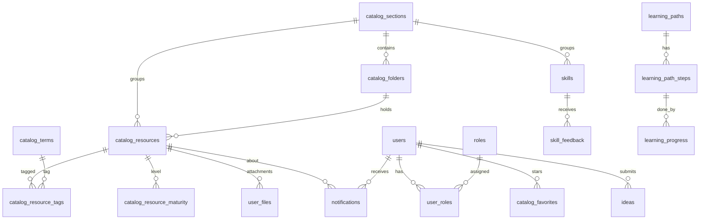

# Архітектура рішення AI Knowledge Hub

**Стек:** Python 3.11+, Flask (REST API), SQLAlchemy + SQLite, Alembic
**Документ:** архітектура рішення, модель прав і структура бази даних

---

## 1. Принципи та ключові рішення

1. **Каталог, а не середовище виконання.** Хаб зберігає, впорядковує й віддає
   AI-знання: навички, промпти, інструкції, кейси, агентів, MCP-сервери,
   посилання. Вбудованого чату з моделями немає, навички на сервері не
   запускаються. Немає й обліку токенів, квот, реєстру моделей і груп доступу:
   усе, що бачить користувач, визначається статусом матеріалу та його роллю.
2. **REST API-first.** Бекенд віддає чистий JSON API. Той самий API
   обслуговує веб-панель і може обслуговувати інші клієнти.
3. **Три ролі.** Адміністратор (`admin`) — усе; менеджер каталогу
   (`skill_manager`) — усе в контексті каталогу; користувач (без ролі) —
   переглядає, коментує, оцінює й публікує власне. Ролі можуть приходити з
   груп Entra ID.
4. **Пост-модерація.** Користувач публікує матеріал чи навичку одразу,
   менеджери отримують сповіщення й модерують уже опубліковане; автор
   дізнається про їхнє рішення з причиною. Попереднього розгляду немає.
5. **Шарова архітектура** (API → Service → ORM) для розділення
   відповідальностей і простоти тестування.
6. **SQLite з можливістю міграції на PostgreSQL.** Працюємо через SQLAlchemy +
   Alembic, без SQLite-специфічних конструкцій без потреби. Схема ведеться
   **версійними міграціями** (`alembic upgrade head`), а не доповненням при
   старті. Довідкові дані (види матеріалів, статуси, рівні, словники) — окрема
   річ: вони синхронізуються при старті, бо це дані, а не схема.
7. **Довідники замість констант.** Види матеріалів, статуси, рівні зрілості,
   рівні повторного використання й акценти — записи `catalog_terms`. Вид
   матеріалу несе свою поведінку даними (`requires_url`, `requires_body`,
   `has_scope`, підписи полів), тому новий вид додається з інтерфейсу без
   релізу.
8. **Файли — поза базою.** Пакети навичок, іконки й вкладення лежать у теках
   стану (`INSTANCE_DIR`), база тримає лише метадані та шляхи.

---

## 2. Технологічний стек

| Шар | Технологія |
| --- | --- |
| Web framework | Flask + Blueprints |
| ORM / міграції | Flask-SQLAlchemy + Alembic |
| Авторизація | Flask-JWT-Extended (JWT access + refresh), Entra ID (OIDC + PKCE) |
| Хешування паролів | Werkzeug (PBKDF2) |
| Планувальник | APScheduler (щоденні нагадування про перегляд матеріалів) |
| Витяг тексту | stdlib для `.txt/.md/.docx`, pypdf для `.pdf` |
| База даних | SQLite, сумісно з PostgreSQL |
| Frontend | Vanilla JS SPA без збірки |

---

## 3. Шари та компоненти

```
┌──────────────────────────────────────────────────────────────┐
│  КЛІЄНТ:  веб-SPA (index.html · app.js · style.css)           │
└───────────────────────────┬──────────────────────────────────┘
                            │ HTTPS / JSON (JWT)
┌───────────────────────────▼──────────────────────────────────┐
│  API LAYER (Flask Blueprints, /api)                           │
│  auth · users · skills · categories · catalog · ideas · paths │
│  ── декоратори RBAC, обробка помилок                          │
├──────────────────────────────────────────────────────────────┤
│  SERVICE LAYER                                                │
│  package · file · search · assistant · review · usage ·       │
│  text_extract · entra                                         │
├──────────────────────────────────────────────────────────────┤
│  DATA ACCESS LAYER (SQLAlchemy models)                        │
└──────────────┬──────────────────────────────┬────────────────┘
               │                              │
     ┌─────────▼─────────┐        ┌───────────▼─────────────┐
     │      SQLite       │        │  Теки стану:            │
     └───────────────────┘        │  skill_packages ·       │
                                  │  skill_icons ·          │
                                  │  user_files             │
                                  └─────────────────────────┘
                 Зовнішнє: Microsoft Entra ID (корпоративний вхід)
```

**Призначення сервісів:**
- **package_service** — пакети навичок: розбір архіву та `skill.md`
  (фронтматер + інструкція), перевірка безпеки архіву (zip-slip, абсолютні
  шляхи, zip-бомби), збереження архіву, перелік файлів, іконки. Нічого не
  розпаковує на диск і не виконує.
- **file_service** — вкладення до карток: тека з GUID-назвою
  (`users.storage_uid`) на кожного, хто завантажує, збереження й видалення.
- **search_service** — пошук мовою задачі: нормалізація, синоніми,
  ранжування за полями картки.
- **assistant_service** — помічник «Опишіть задачу»: добирає картки пошуком і
  пояснює, які слова задачі збіглися. Детермінований, без моделі ШІ.
- **review_service** — сповіщення: менеджерам про публікації й зміни
  користувачів, авторам про рішення менеджерів і коментарі, власникам —
  нагадування про перегляд (щодня через APScheduler).
- **comment_service** — публічні коментарі й оцінки під картками (одна
  оцінка на людину), права на видалення.
- **usage_service** — облік переглядів і сесій для аналітики та KPI.
- **text_extract_service** — текст із `.txt/.md/.docx/.pdf` для майстра
  «Додати матеріал».
- **entra_service** — OIDC-вхід через Entra ID і зіставлення груп із ролями.

---

## 4. Модель безпеки та матриця прав

| Дія | Адміністратор | Менеджер каталогу | Користувач |
| --- | :---: | :---: | :---: |
| Керування користувачами, ролями, паролями | ✓ | ✗ | ✗ |
| Перегляд і використання опублікованого контенту | ✓ | ✓ | ✓ |
| Коментарі, оцінки, «Обране», ідеї, маршрути навчання | ✓ | ✓ | ✓ |
| Публікація власних матеріалів і навичок (або чернетка) | ✓ | ✓ | ✓ |
| Редагування, зняття з публікації, видалення **власного** | ✓ | ✓ | ✓ |
| Редагування, зняття з публікації, архів, видалення **будь-чийого** | ✓ | ✓ | ✗ |
| Перегляд чужих чернеток | ✓ | ✓ | ✗ |
| Видалення будь-якого коментаря | ✓ | ✓ | лише свій |
| Розділи, колекції, довідники, синоніми, маршрути | ✓ | ✓ | ✗ |
| Розгляд ідей, аналітика, KPI, стрічка коментарів команди | ✓ | ✓ | ✗ |

> Перевірка прав — декоратори `@require_auth` і
> `@require_global_role('admin', 'skill_manager')` з `app/core/permissions.py`.
> Видимість окремого запису (чернетка навички, чужа чернетка матеріалу)
> перевіряється в обробнику (автор чи менеджер): для навички — 404, щоб не
> підтверджувати сам факт чернетки.

---

## 5. Структура проєкту

```
smart-digital-skills/
├── app/
│   ├── __init__.py            # фабрика застосунку (create_app), планувальник
│   ├── config.py              # конфіги Dev/Prod, теки стану, секрети
│   ├── extensions.py          # db, jwt, cors
│   ├── models/                # user · skill · resource · file · idea ·
│   │                          # learning · notification · survey · usage · setting
│   ├── api/                   # auth · users · skills · categories · catalog · ideas · paths
│   ├── services/              # бізнес-логіка (див. розділ 3)
│   ├── core/
│   │   ├── security.py        # хеш паролів, JWT, поточний користувач
│   │   ├── permissions.py     # декоратори RBAC
│   │   ├── errors.py
│   │   └── schema.py          # синхронізація довідників, запасне доповнення схеми
│   └── static/                # SPA: index.html, app.js, style.css, hero.jpg
│       └── fonts/             # Inter var (SIL OFL) — без зовнішніх запитів
├── docs/
│   ├── DESIGN.md              # візуальна мова, токени, модель навігації
│   ├── GOVERNANCE.md          # регламент управління контентом (BR-10)
│   └── ROLE-SERVICE-SUPPORT.md # роль операційної підтримки (BR-11а)
├── migrations/                # Alembic
├── examples/skills/           # приклад пакета навички
├── scripts/
│   ├── init_db.py             # міграції + довідники
│   ├── seed.py                # демо-дані
│   └── backup_db.py           # онлайн-копія SQLite
├── tests/
├── instance/                  # стан: profihub.db, skill_packages, skill_icons, user_files
├── requirements.txt
├── .env.example
├── startup.sh
└── wsgi.py
```

---

## 6. Структура бази даних

### ER-зв'язки (стисло)



### Опис таблиць

| Таблиця | Призначення |
| --- | --- |
| `roles` / `user_roles` | Глобальні ролі (`admin`, `skill_manager`) і їх призначення |
| `users` | Користувачі (логін/пароль або Entra ID, `storage_uid` для тек вкладень) |
| `refresh_tokens` | Refresh-токени JWT |
| `skills` | Навички: атрибути, інструкція, пакет (`package_path`), статус, версія, `downloads_count` |
| `skill_categories` | Довідник категорій навичок |
| `skill_feedback` | Коментарі й оцінки під картками (навички й матеріали); `is_public = 0` — старі приватні відгуки |
| `catalog_sections` / `catalog_folders` | Розділи й колекції каталогу |
| `catalog_terms` | Довідники: теги, складність, бізнес-цінність, види матеріалів, рівні зрілості |
| `catalog_resources` | Матеріали: промпти, інструкції, кейси, агенти, MCP, посилання |
| `catalog_resource_tags` / `catalog_resource_maturity` | Теги та рівні зрілості картки |
| `catalog_favorites` | «Обране» (спільне для навичок і матеріалів) |
| `user_files` | Вкладення до карток каталогу |
| `review_logs` | Журнал переходів статусів (матеріали й навички) з причиною |
| `notifications` | Сповіщення: публікації користувачів, рішення менеджерів, коментарі, нагадування; посилання на матеріал або навичку |
| `ideas` | Воронка ідей |
| `search_synonyms` / `search_query_logs` | Словник формулювань задач і лог пошуку |
| `learning_paths` / `learning_path_steps` / `learning_progress` | Навчальні маршрути, кроки, прогрес |
| `hidden_recommendations` | Рекомендації, які користувач приховав |
| `user_sessions` / `resource_views` | Сесії та перегляди — джерело DAU/WAU/MAU і KPI |
| `survey_responses` / `survey_prompts` | Опитування NPS/CSAT/CES і коли питали востаннє |
| `app_settings` | Налаштування застосунку (сувора публікація, частота опитувань) |

---

## 7. SQL DDL (SQLite)

Нижче — DDL, згенерований із поточних моделей SQLAlchemy. Авторитетне
джерело схеми — міграції в `migrations/versions/`; `tests/test_migrations.py`
перевіряє, що вони збігаються з моделями. Актуальний DDL можна отримати з
чистої бази (офлайн-режим `--sql` не підходить: batch-міграції SQLite
потребують живого з'єднання):

```bash
DATABASE_URL=sqlite:////tmp/schema.db alembic upgrade head && sqlite3 /tmp/schema.db .schema
```

```sql
CREATE TABLE app_settings (
    id INTEGER NOT NULL,
    "key" VARCHAR NOT NULL,
    value VARCHAR,
    updated_at DATETIME NOT NULL,
    PRIMARY KEY (id),
    UNIQUE ("key")
);

CREATE TABLE catalog_sections (
    id INTEGER NOT NULL,
    name VARCHAR NOT NULL,
    description TEXT,
    icon_emoji VARCHAR,
    accent VARCHAR,
    url VARCHAR,
    position INTEGER NOT NULL,
    is_active BOOLEAN NOT NULL,
    created_at DATETIME NOT NULL,
    PRIMARY KEY (id),
    UNIQUE (name)
);

CREATE TABLE catalog_terms (
    id INTEGER NOT NULL,
    kind VARCHAR NOT NULL,
    name VARCHAR NOT NULL,
    name_norm VARCHAR NOT NULL,
    code VARCHAR,
    description TEXT,
    position INTEGER NOT NULL,
    is_active BOOLEAN NOT NULL,
    icon_emoji VARCHAR,
    color VARCHAR,
    requires_url BOOLEAN NOT NULL,
    requires_body BOOLEAN NOT NULL,
    has_scope BOOLEAN NOT NULL,
    url_label VARCHAR,
    body_label VARCHAR,
    created_at DATETIME NOT NULL,
    PRIMARY KEY (id),
    UNIQUE (kind, name_norm)
);

CREATE TABLE roles (
    id INTEGER NOT NULL,
    code VARCHAR NOT NULL,
    name VARCHAR NOT NULL,
    description TEXT,
    PRIMARY KEY (id),
    UNIQUE (code)
);

CREATE TABLE search_synonyms (
    id INTEGER NOT NULL,
    phrase VARCHAR NOT NULL,
    terms VARCHAR NOT NULL,
    is_active BOOLEAN NOT NULL,
    created_at DATETIME NOT NULL,
    PRIMARY KEY (id)
);

CREATE TABLE skill_categories (
    id INTEGER NOT NULL,
    name VARCHAR NOT NULL,
    created_at DATETIME NOT NULL,
    PRIMARY KEY (id),
    UNIQUE (name)
);

CREATE TABLE catalog_folders (
    id INTEGER NOT NULL,
    section_id INTEGER NOT NULL,
    name VARCHAR NOT NULL,
    description TEXT,
    icon_emoji VARCHAR,
    position INTEGER NOT NULL,
    is_active BOOLEAN NOT NULL,
    created_at DATETIME NOT NULL,
    PRIMARY KEY (id),
    UNIQUE (section_id, name),
    FOREIGN KEY(section_id) REFERENCES catalog_sections (id)
);

CREATE TABLE learning_paths (
    id INTEGER NOT NULL,
    name VARCHAR NOT NULL,
    description TEXT,
    icon_emoji VARCHAR,
    maturity_level_id INTEGER,
    audience_role VARCHAR,
    is_starter BOOLEAN NOT NULL,
    position INTEGER NOT NULL,
    is_active BOOLEAN NOT NULL,
    created_at DATETIME NOT NULL,
    PRIMARY KEY (id),
    UNIQUE (name),
    FOREIGN KEY(maturity_level_id) REFERENCES catalog_terms (id)
);

CREATE TABLE users (
    id INTEGER NOT NULL,
    username VARCHAR NOT NULL,
    email VARCHAR,
    password_hash VARCHAR,
    full_name VARCHAR,
    auth_provider VARCHAR NOT NULL,
    external_id VARCHAR,
    is_active BOOLEAN NOT NULL,
    is_system_admin BOOLEAN NOT NULL,
    storage_uid VARCHAR,
    maturity_level_id INTEGER,
    department VARCHAR,
    last_login_at DATETIME,
    created_at DATETIME NOT NULL,
    updated_at DATETIME NOT NULL,
    PRIMARY KEY (id),
    UNIQUE (username),
    UNIQUE (email),
    UNIQUE (storage_uid),
    FOREIGN KEY(maturity_level_id) REFERENCES catalog_terms (id)
);

CREATE TABLE catalog_favorites (
    id INTEGER NOT NULL,
    user_id INTEGER NOT NULL,
    item_type VARCHAR NOT NULL,
    item_id INTEGER NOT NULL,
    created_at DATETIME NOT NULL,
    PRIMARY KEY (id),
    UNIQUE (user_id, item_type, item_id),
    FOREIGN KEY(user_id) REFERENCES users (id) ON DELETE CASCADE
);

CREATE TABLE catalog_resources (
    id INTEGER NOT NULL,
    resource_type VARCHAR NOT NULL,
    name VARCHAR NOT NULL,
    description TEXT NOT NULL,
    category VARCHAR,
    author VARCHAR,
    tags VARCHAR,
    body TEXT,
    url VARCHAR,
    link_scope VARCHAR,
    section_id INTEGER,
    folder_id INTEGER,
    complexity_id INTEGER,
    business_value_id INTEGER,
    owner VARCHAR,
    owner_contact VARCHAR,
    tools VARCHAR,
    reuse_level VARCHAR,
    reuse_guidance TEXT,
    reviewed_at DATETIME,
    next_review_at DATETIME,
    icon_emoji VARCHAR,
    accent VARCHAR,
    is_featured BOOLEAN NOT NULL,
    status VARCHAR NOT NULL,
    review_note TEXT,
    version VARCHAR NOT NULL,
    opens_count INTEGER NOT NULL,
    created_by INTEGER,
    created_at DATETIME NOT NULL,
    updated_at DATETIME NOT NULL,
    published_at DATETIME,
    PRIMARY KEY (id),
    FOREIGN KEY(section_id) REFERENCES catalog_sections (id),
    FOREIGN KEY(folder_id) REFERENCES catalog_folders (id),
    FOREIGN KEY(complexity_id) REFERENCES catalog_terms (id),
    FOREIGN KEY(business_value_id) REFERENCES catalog_terms (id),
    FOREIGN KEY(created_by) REFERENCES users (id)
);

CREATE TABLE hidden_recommendations (
    id INTEGER NOT NULL,
    user_id INTEGER NOT NULL,
    item_type VARCHAR NOT NULL,
    item_id INTEGER NOT NULL,
    created_at DATETIME NOT NULL,
    PRIMARY KEY (id),
    UNIQUE (user_id, item_type, item_id),
    FOREIGN KEY(user_id) REFERENCES users (id) ON DELETE CASCADE
);

CREATE INDEX ix_hidden_recommendations_user_id ON hidden_recommendations (user_id);

CREATE TABLE refresh_tokens (
    id INTEGER NOT NULL,
    user_id INTEGER NOT NULL,
    token_hash VARCHAR NOT NULL,
    expires_at DATETIME NOT NULL,
    revoked BOOLEAN NOT NULL,
    created_at DATETIME NOT NULL,
    PRIMARY KEY (id),
    FOREIGN KEY(user_id) REFERENCES users (id) ON DELETE CASCADE
);

CREATE TABLE review_logs (
    id INTEGER NOT NULL,
    item_type VARCHAR NOT NULL,
    item_id INTEGER NOT NULL,
    item_name VARCHAR,
    actor_user_id INTEGER,
    actor_name VARCHAR,
    from_status VARCHAR,
    to_status VARCHAR NOT NULL,
    note TEXT,
    created_at DATETIME NOT NULL,
    PRIMARY KEY (id),
    FOREIGN KEY(actor_user_id) REFERENCES users (id) ON DELETE SET NULL
);

CREATE TABLE search_query_logs (
    id INTEGER NOT NULL,
    "query" VARCHAR NOT NULL,
    query_norm VARCHAR NOT NULL,
    results_count INTEGER NOT NULL,
    section_id INTEGER,
    kind VARCHAR,
    user_id INTEGER,
    opened_item_type VARCHAR,
    opened_item_id INTEGER,
    assistant_helpful BOOLEAN,
    created_at DATETIME NOT NULL,
    PRIMARY KEY (id),
    FOREIGN KEY(section_id) REFERENCES catalog_sections (id),
    FOREIGN KEY(user_id) REFERENCES users (id) ON DELETE SET NULL
);

CREATE TABLE skills (
    id INTEGER NOT NULL,
    name VARCHAR NOT NULL,
    description TEXT NOT NULL,
    author VARCHAR,
    category VARCHAR,
    section_id INTEGER,
    folder_id INTEGER,
    owner VARCHAR,
    icon_path VARCHAR,
    skill_kind VARCHAR NOT NULL,
    prompt_template TEXT,
    input_spec TEXT,
    output_spec TEXT,
    starter_prompt TEXT,
    package_filename VARCHAR,
    package_path VARCHAR,
    status VARCHAR NOT NULL,
    version VARCHAR NOT NULL,
    downloads_count INTEGER NOT NULL,
    created_by INTEGER,
    created_at DATETIME NOT NULL,
    updated_at DATETIME NOT NULL,
    published_at DATETIME,
    PRIMARY KEY (id),
    FOREIGN KEY(section_id) REFERENCES catalog_sections (id),
    FOREIGN KEY(folder_id) REFERENCES catalog_folders (id),
    FOREIGN KEY(created_by) REFERENCES users (id)
);

CREATE TABLE survey_prompts (
    id INTEGER NOT NULL,
    user_id INTEGER NOT NULL,
    kind VARCHAR NOT NULL,
    shown_at DATETIME NOT NULL,
    answered BOOLEAN NOT NULL,
    PRIMARY KEY (id),
    UNIQUE (user_id, kind),
    FOREIGN KEY(user_id) REFERENCES users (id) ON DELETE CASCADE
);

CREATE TABLE survey_responses (
    id INTEGER NOT NULL,
    kind VARCHAR NOT NULL,
    score INTEGER NOT NULL,
    comment TEXT,
    user_id INTEGER,
    user_role VARCHAR,
    context VARCHAR,
    context_id INTEGER,
    created_at DATETIME NOT NULL,
    day DATE NOT NULL,
    PRIMARY KEY (id),
    FOREIGN KEY(user_id) REFERENCES users (id) ON DELETE SET NULL
);

CREATE INDEX ix_survey_responses_day ON survey_responses (day);

CREATE TABLE user_roles (
    user_id INTEGER NOT NULL,
    role_id INTEGER NOT NULL,
    PRIMARY KEY (user_id, role_id),
    FOREIGN KEY(user_id) REFERENCES users (id) ON DELETE CASCADE,
    FOREIGN KEY(role_id) REFERENCES roles (id) ON DELETE CASCADE
);

CREATE TABLE user_sessions (
    id INTEGER NOT NULL,
    user_id INTEGER NOT NULL,
    started_at DATETIME NOT NULL,
    last_seen_at DATETIME NOT NULL,
    ended_at DATETIME,
    views_count INTEGER NOT NULL,
    day DATE NOT NULL,
    PRIMARY KEY (id),
    FOREIGN KEY(user_id) REFERENCES users (id) ON DELETE CASCADE
);

CREATE INDEX ix_user_sessions_day ON user_sessions (day);
CREATE INDEX ix_user_sessions_user_id ON user_sessions (user_id);

CREATE TABLE catalog_resource_maturity (
    id INTEGER NOT NULL,
    resource_id INTEGER NOT NULL,
    term_id INTEGER NOT NULL,
    PRIMARY KEY (id),
    UNIQUE (resource_id, term_id),
    FOREIGN KEY(resource_id) REFERENCES catalog_resources (id) ON DELETE CASCADE,
    FOREIGN KEY(term_id) REFERENCES catalog_terms (id) ON DELETE CASCADE
);

CREATE TABLE catalog_resource_tags (
    id INTEGER NOT NULL,
    resource_id INTEGER NOT NULL,
    term_id INTEGER NOT NULL,
    PRIMARY KEY (id),
    UNIQUE (resource_id, term_id),
    FOREIGN KEY(resource_id) REFERENCES catalog_resources (id) ON DELETE CASCADE,
    FOREIGN KEY(term_id) REFERENCES catalog_terms (id) ON DELETE CASCADE
);

CREATE TABLE ideas (
    id INTEGER NOT NULL,
    title VARCHAR NOT NULL,
    body TEXT NOT NULL,
    problem TEXT,
    expected_effect TEXT,
    contact VARCHAR,
    author_id INTEGER,
    author_name VARCHAR,
    source_resource_id INTEGER,
    resource_id INTEGER,
    external_url VARCHAR,
    status VARCHAR NOT NULL,
    status_note TEXT,
    created_at DATETIME NOT NULL,
    updated_at DATETIME NOT NULL,
    PRIMARY KEY (id),
    FOREIGN KEY(author_id) REFERENCES users (id) ON DELETE SET NULL,
    FOREIGN KEY(source_resource_id) REFERENCES catalog_resources (id),
    FOREIGN KEY(resource_id) REFERENCES catalog_resources (id)
);

CREATE TABLE learning_path_steps (
    id INTEGER NOT NULL,
    path_id INTEGER NOT NULL,
    position INTEGER NOT NULL,
    title VARCHAR,
    note TEXT,
    resource_id INTEGER,
    external_url VARCHAR,
    PRIMARY KEY (id),
    FOREIGN KEY(path_id) REFERENCES learning_paths (id) ON DELETE CASCADE,
    FOREIGN KEY(resource_id) REFERENCES catalog_resources (id)
);

CREATE TABLE notifications (
    id INTEGER NOT NULL,
    user_id INTEGER NOT NULL,
    kind VARCHAR NOT NULL,
    title VARCHAR NOT NULL,
    body TEXT,
    resource_id INTEGER,
    skill_id INTEGER,
    dedupe_key VARCHAR NOT NULL,
    is_read BOOLEAN NOT NULL,
    created_at DATETIME NOT NULL,
    PRIMARY KEY (id),
    UNIQUE (user_id, dedupe_key),
    FOREIGN KEY(user_id) REFERENCES users (id) ON DELETE CASCADE,
    FOREIGN KEY(resource_id) REFERENCES catalog_resources (id) ON DELETE CASCADE,
    FOREIGN KEY(skill_id) REFERENCES skills (id) ON DELETE CASCADE
);

CREATE INDEX ix_notifications_user_id ON notifications (user_id);

CREATE TABLE resource_views (
    id INTEGER NOT NULL,
    user_id INTEGER,
    target_type VARCHAR NOT NULL,
    target_id INTEGER NOT NULL,
    target_name VARCHAR,
    session_id INTEGER,
    created_at DATETIME NOT NULL,
    day DATE NOT NULL,
    PRIMARY KEY (id),
    FOREIGN KEY(user_id) REFERENCES users (id) ON DELETE SET NULL,
    FOREIGN KEY(session_id) REFERENCES user_sessions (id) ON DELETE SET NULL
);

CREATE INDEX ix_resource_views_day ON resource_views (day);
CREATE INDEX ix_resource_views_user_id ON resource_views (user_id);

CREATE TABLE skill_feedback (
    id INTEGER NOT NULL,
    item_type VARCHAR NOT NULL,
    skill_id INTEGER,
    resource_id INTEGER,
    skill_name VARCHAR NOT NULL,
    skill_version VARCHAR,
    rating INTEGER,
    user_id INTEGER,
    username VARCHAR,
    message TEXT NOT NULL,
    is_public BOOLEAN NOT NULL,
    is_read BOOLEAN NOT NULL,
    created_at DATETIME NOT NULL,
    PRIMARY KEY (id),
    FOREIGN KEY(skill_id) REFERENCES skills (id) ON DELETE SET NULL,
    FOREIGN KEY(resource_id) REFERENCES catalog_resources (id) ON DELETE SET NULL,
    FOREIGN KEY(user_id) REFERENCES users (id) ON DELETE SET NULL
);

CREATE TABLE user_files (
    id INTEGER NOT NULL,
    user_id INTEGER NOT NULL,
    filename VARCHAR NOT NULL,
    stored_name VARCHAR NOT NULL,
    content_type VARCHAR,
    size INTEGER NOT NULL,
    source VARCHAR NOT NULL,
    resource_id INTEGER,
    created_at DATETIME NOT NULL,
    PRIMARY KEY (id),
    FOREIGN KEY(user_id) REFERENCES users (id) ON DELETE CASCADE,
    FOREIGN KEY(resource_id) REFERENCES catalog_resources (id)
);

CREATE TABLE learning_progress (
    id INTEGER NOT NULL,
    user_id INTEGER NOT NULL,
    path_id INTEGER NOT NULL,
    step_id INTEGER NOT NULL,
    completed_at DATETIME NOT NULL,
    PRIMARY KEY (id),
    UNIQUE (user_id, step_id),
    FOREIGN KEY(user_id) REFERENCES users (id) ON DELETE CASCADE,
    FOREIGN KEY(path_id) REFERENCES learning_paths (id) ON DELETE CASCADE,
    FOREIGN KEY(step_id) REFERENCES learning_path_steps (id) ON DELETE CASCADE
);

CREATE INDEX ix_learning_progress_path_id ON learning_progress (path_id);
CREATE INDEX ix_learning_progress_user_id ON learning_progress (user_id);
```

---

## 8. Початкові дані (seed)

- **Ролі:** `admin`, `skill_manager`.
- **Супер-адмін:** `admin` (`ADMIN_USERNAME` / `ADMIN_PASSWORD`, `is_system_admin = 1`).
- **Демо-користувачі:** `skillmanager` (менеджер каталогу), `user1`, `user2`.
- **Навички:** `Summarizer` — інструкція без пакета (зі стартовим промптом);
  `Word Counter` — пакет, зібраний з `examples/skills/word-counter`.
- **Каталог:** розділи, колекції, довідники, демо-матеріали всіх видів,
  навчальні маршрути.

`seed --if-empty` наповнює лише порожню базу — так його безпечно викликати
на кожному старті контейнера.

---

## 9. Ключові бізнес-правила

1. **Скоуп менеджера каталогу** — увесь контент каталогу, навички, ідеї,
   маршрути, коментарі й аналітика. Користувачами та ролями керує лише
   адміністратор.

2. **Видимість чернетки.** Чернетку матеріалу чи навички бачать лише автор і
   менеджери; для решти навички-чернетки не існує (404). Опубліковане
   доступне всім.

3. **Навички — хостинг.** Пакет приймається лише після перевірки безпеки
   архіву: шляхи з `..`, абсолютні шляхи, розмір у розпакованому вигляді
   (`SKILL_PACKAGE_MAX_UNZIPPED`). Сервер архів не розпаковує на диск і не
   виконує. Атрибути й інструкція беруться з фронтматеру й тіла `skill.md`.

4. **Лічильник завантажень.** Кожне завантаження пакета опублікованої навички
   збільшує `downloads_count` атомарним `UPDATE … SET downloads_count =
   downloads_count + 1`, тож паралельні завантаження не губляться. Перевірки
   менеджерів на чернетках у лічильник не йдуть. Лічильник — популярність
   навички в каталозі.

5. **Версії навички.** Пакет без контексту створює нову навичку; пакет у
   контексті наявної — її нову версію: ідентифікатор, лічильник, відгуки,
   іконка й розміщення зберігаються. Видалення навички прибирає пакет, іконку
   й «Обране»; відгуки лишаються без прив'язки.

6. **Життєвий цикл і пост-модерація:** `draft ⇄ published → needs_update →
   archived`. Автор сам публікує свій матеріал і знімає його з публікації;
   архів і «потребує оновлення» — інструменти менеджера. Публікація
   користувача (і зміна опублікованого, не частіше разу на добу) створює
   сповіщення всім менеджерам; рішення менеджера щодо чужого матеріалу
   (зняття, архів, видалення) — сповіщення авторові з причиною, яка
   лишається в `review_note`. Користувацька публікація без власника й дати
   перегляду отримує їх автоматично: власник — автор, перегляд — через
   6 місяців. Кожен перехід пишеться в `review_logs`.

7. **Вкладення.** Файл картки видимий тим, хто бачить картку, і віддається
   лише з JWT. Видалення картки видаляє її вкладення (з диска теж) і
   сповіщення про неї.

8. **Видалення користувача — явний каскад.** У SQLite перевірка зовнішніх
   ключів типово вимкнена, тому обробник сам видаляє особисте (ролі, токени,
   обране, сповіщення, прогрес, завантажені ним вкладення, сесії) і
   відв'язує історію (ідеї, журнали, відгуки, перегляди). Себе й системного
   адміністратора видалити не можна.

9. **Коментарі публічні, оцінка — одна на людину.** Нова оцінка обнуляє
   попередню того самого користувача; оцінка без тексту рахується в
   середньому, але в стрічку не потрапляє. Видалення коментаря з оцінкою
   прибирає лише текст. Автор матеріалу отримує сповіщення про коментар.

10. **Помічник пошуку не вигадує.** Відповідь складається лише з карток, які
   знайшов пошук по базі; пояснення будується зі збігу слів задачі.

11. **Нагадування власникам** про перегляд матеріалів формуються щодня о
    07:00 UTC планувальником у процесі застосунку. Дублів не буде навіть
    за кількох процесів: сповіщення має унікальний ключ у базі.

---

## 10. Історія обсягу

| Етап | Обсяг |
| --- | --- |
| **MVP** | Логін/пароль, JWT; користувачі й ролі; каталог навичок; чат із моделями, облік токенів, групи |
| **Хвилі BR-01…BR-16** | Розділи й колекції, життєвий цикл і розгляд матеріалів, пошук мовою задачі, помічник, рекомендації, маршрути, ідеї, аналітика й KPI, Entra ID |
| **Жовтень 2026** | Хаб став чистим каталогом знань: прибрано чат, LLM-інтеграції, веб-пошук, запуск навичок, групи, квоти, облік токенів, доступи до моделей і навичок. Навички хостяться й завантажуються (міграція `b7e2d4f6a8c1`) |
| **Жовтень 2026** | Три ролі й пост-модерація: користувач публікує все сам, менеджер каталогу модерує опубліковане; публічні коментарі з оцінкою (міграція `e5a7c9d1f3b6`) |
