# Перші кроки в AI Knowledge Hub

Інструкція для нових користувачів: що це за сервіс і як виконати головні дії.
Читається за 10 хвилин.

У застосунку ця інструкція відкривається значком **«?»** у правому верхньому
куті та пунктом **«Інструкція»** бічної панелі (сторінка `/guide/`,
файл `app/static/guide/index.html`). Змінюючи текст тут, оновіть і її.

---

## Коротко про хаб

**AI Knowledge Hub** — каталог AI-знань компанії. Тут зібрано навички,
промпти, інструкції, кейси, агенти, MCP-сервери й корисні посилання, які
колеги вже перевірили в роботі.

- **Знаходьте готове.** Не починайте з нуля: імовірно, хтось уже розв'язав
  схожу задачу.
- **Хаб нічого не запускає.** Ви берете матеріал і використовуєте його у
  своєму інструменті: Claude, ChatGPT, Copilot, корпоративному агенті.
- **Діліться своїм.** Додавайте власні промпти, інструкції й навички, щоб
  колеги могли ними скористатися.

### Ролі

| Роль | Що може |
| --- | --- |
| **Користувач** | Шукає й використовує матеріали, оцінює, коментує, подає ідеї, додає власні матеріали й навички та подає їх на розгляд |
| **Менеджер розділу** | Усе те саме, а також схвалює або повертає матеріали своїх розділів, редагує, знімає з публікації й видаляє їх |
| **Адміністратор** | Модерує будь-який розділ, веде структуру каталогу й маршрути, керує користувачами, ролями й розділами менеджерів |

Ролі призначає адміністратор. Позначки «Експерт» і «Відповідальний за ідеї»
він ставить у профілі користувача.

---

## 1. Знайти потрібне

Першою відкривається сторінка **«Для вас»**: під привітанням ваш рівень
роботи з AI, нижче — «Рекомендовано вам» (дібрано за рівнем і тим, що ви вже
дивилися) і «Нещодавно додані» (найсвіжіші матеріали каталогу).

**Якщо знаєте, що шукаєте**

1. Клацніть у поле пошуку вгорі або натисніть `Ctrl+K`.
2. Введіть кілька слів: «протокол наради», «тендер», «договір».
3. Відкриються «Матеріали» лише з відповідними картками.

**Якщо хочете переглянути все**

1. У бічній панелі натисніть **«Матеріали»**.
2. Оберіть вид угорі: «Навички», «Промпти», «Інструкції» тощо.
3. Натисніть **«Фільтри»**, щоб звузити за категорією, складністю,
   інструментом, власником чи тегом.
4. Вибрані фільтри видно під рядком. Хрестик знімає один фільтр,
   **«Скинути всі»** знімає всі.

На плитці під описом — до трьох тегів. **Клацніть тег**, щоб побачити всі
матеріали з ним; так само працюють теги в картці.

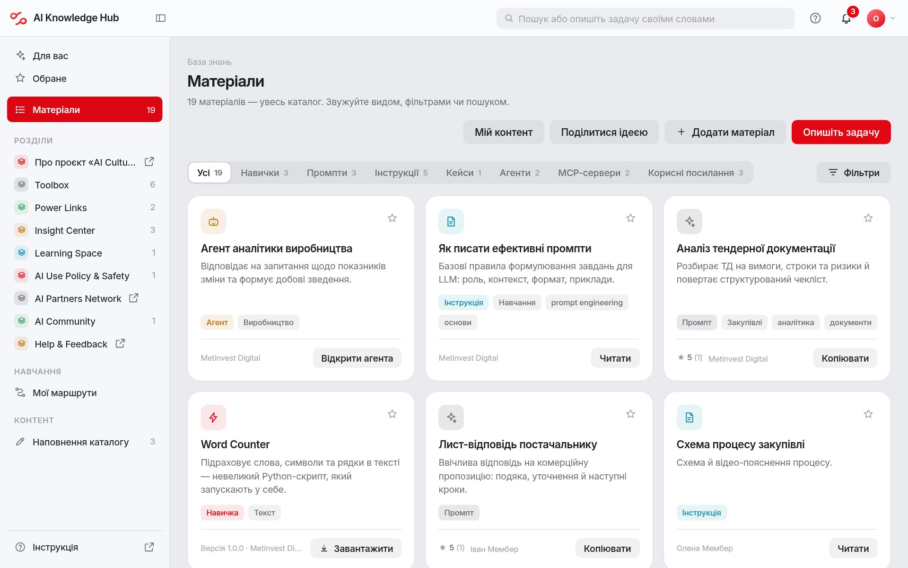

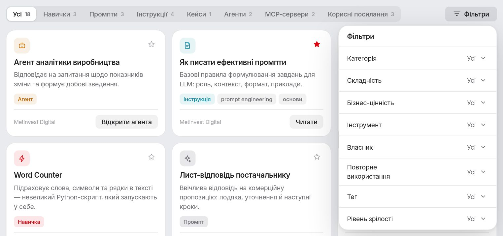

**Якщо не знаєте, як це називається**

1. Натисніть **«Опишіть задачу»**.
2. Напишіть своїми словами, що потрібно зробити: «потрібен протокол наради».
3. Помічник покаже матеріали й пояснить, чому кожен підходить.
4. Помічник шукає лише серед матеріалів хабу й нічого не вигадує.

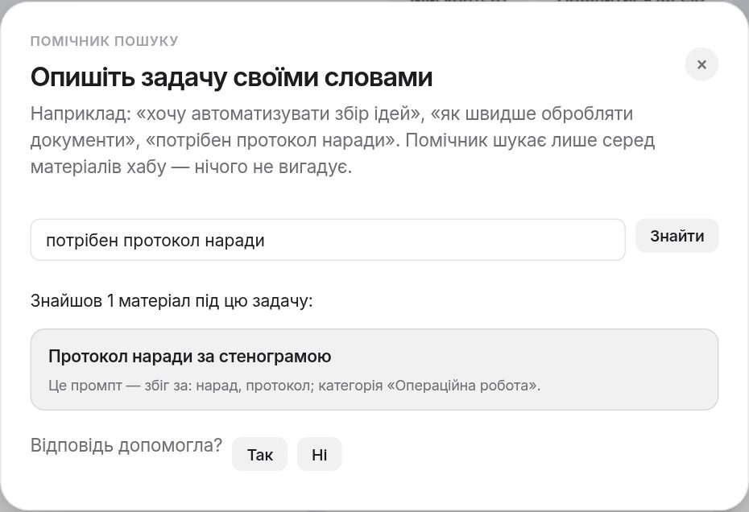

---

## 2. Скористатися матеріалом

1. Натисніть на картку. Відкриється повний опис.
2. Натисніть головну кнопку: **«Копіювати»** для промпту,
   **«Завантажити пакет»** для навички, **«Відкрити агента»** для агента.
3. Інструкції й кейси читайте просто в картці.
4. Унизу картки є файли. Зображення й відео показуються одразу: клацніть
   мініатюру чи картинку в тексті, щоб відкрити її на весь екран.

Головну кнопку можна натиснути й просто на плитці в каталозі, не
відкриваючи картку.

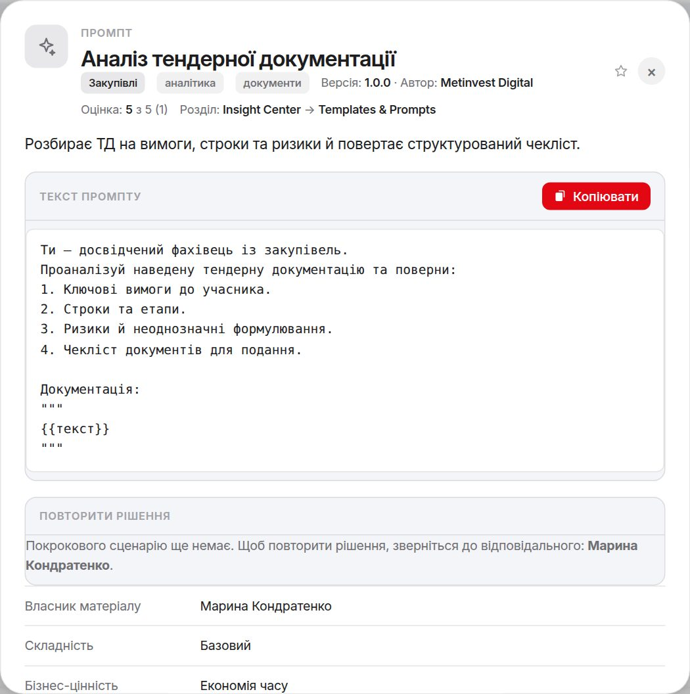

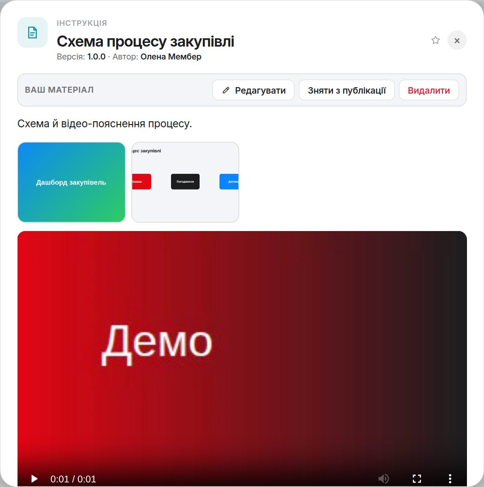

---

## 3. Зберегти на потім

1. Натисніть **зірочку** на плитці або в картці.
2. Збережене з'явиться в бічній панелі в **«Обраному»**.
3. Нещодавно відкриті матеріали — у пункті **«Нещодавні»**.

---

## 4. Оцінити й прокоментувати

Унизу кожної картки є блок **«Обговорення»**.

1. Поставте оцінку від 1 до 5 зірок. Оцінку можна змінити будь-коли.
2. Напишіть коментар: досвід використання, питання авторові, що покращити.
3. Натисніть **«Надіслати»**. Коментар побачать усі, а автор отримає
   сповіщення.

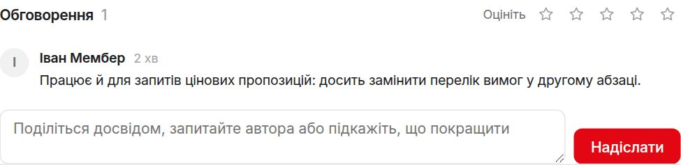

---

## 5. Опублікувати свій матеріал

Промпт, інструкцію, кейс, агента, MCP-сервер чи посилання додають за три
кроки.

1. Натисніть **«Додати матеріал»**: на сторінці «Для вас», у «Матеріалах»
   або в «Наповненні каталогу».
2. **Вид.** Оберіть, що додаєте.
3. **Зміст.** Напишіть текст у редакторі або вставте його з Word, Google
   Docs чи сайту: заголовки, жирний шрифт, списки, таблиці й посилання
   збережуться. Можна й перетягнути файл `.docx`, `.pdf`, `.md`, `.txt`:
   текст з'явиться в редакторі разом з оформленням і картинками. Нижче можна
   додати файли до картки: презентацію, таблицю, відео.
4. **Опис.** Дайте назву, яка описує задачу («Аналіз тендерної
   документації»), і короткий опис. Розділ, категорія й теги допоможуть
   колегам знайти матеріал.
5. Натисніть **«Подати на розгляд»**. Розділ обов'язковий: його менеджер
   розгляне матеріал. Якщо матеріал ще не готовий, оберіть **«Зберегти
   чернетку»** поруч: чернетку бачите лише ви й менеджери розділу.

Менеджер розділу отримає сповіщення й схвалить матеріал або поверне його з
причиною — ви отримаєте сповіщення про рішення. Після схвалення матеріал
бачать усі, а **власником стаєте ви**. Якщо ви самі модеруєте обраний розділ,
кнопка називається **«Опублікувати»** і матеріал з'являється одразу.

Змінити вже опублікований матеріал можна будь-коли: зміни чекають
схвалення, а в каталозі тим часом лишається попередня версія. Поки зміни на
розгляді, їх можна скасувати кнопкою **«Скасувати зміни»** в картці.

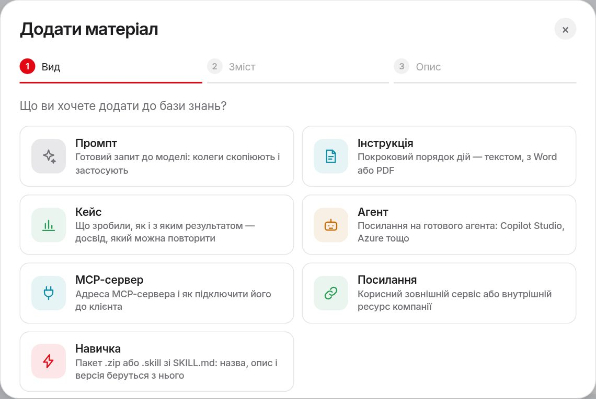

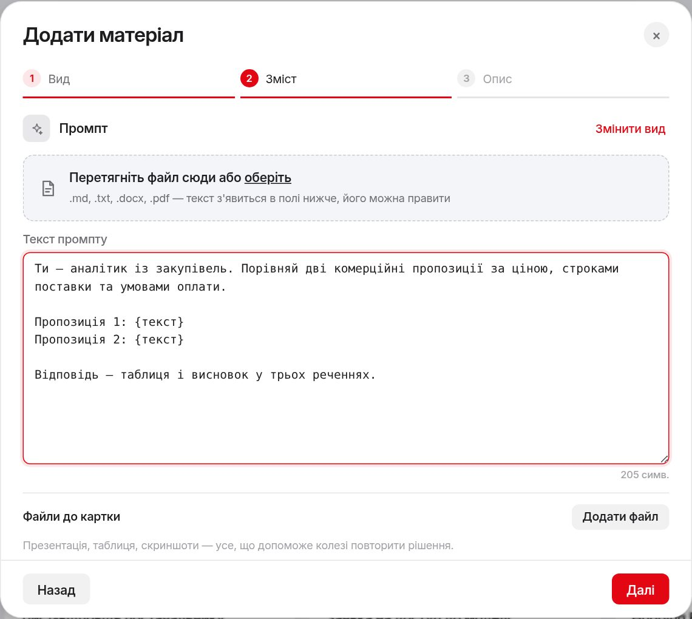

> **Панель над текстом** оформлює виділене: заголовок, жирний, курсив, код,
> списки, цитата, посилання, зображення, таблиця й розділювач. Працюють і
> клавіші `Ctrl+B`, `Ctrl+I`, `Ctrl+K`. Вкладка «Markdown» показує той самий
> текст розміткою.
>
> **Картинку** вставляє кнопка «Зображення»; підійде й знімок екрана
> (`Ctrl+V`) чи файл, перетягнутий у текст. Картинки з документа Word
> переносяться, коли ви завантажуєте сам файл `.docx`. Шрифти й кольори
> свідомо не переносяться, щоб усі картки виглядали однаково.

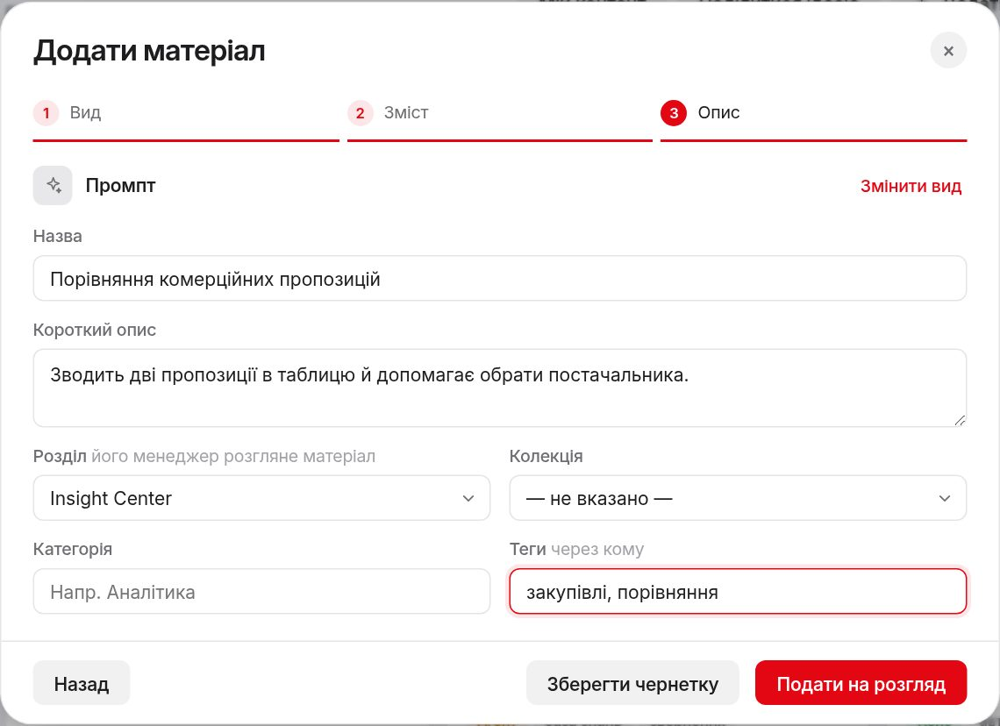

---

## 6. Опублікувати навичку

Навичка — це пакет `.zip` або `.skill` з файлом `SKILL.md` усередині.

1. Натисніть **«Додати матеріал»** і оберіть **«Навичка»**.
2. Перетягніть пакет у віконце або натисніть **«оберіть»**.
3. Натисніть **«Опублікувати»** або **«Зберегти чернетку»**.

Назва, опис, версія й автор беруться з `SKILL.md`. Іконку та інструкцію
можна змінити згодом: відкрийте картку навички й натисніть **«Редагувати»**.

---

## 7. Керувати своїми матеріалами

У бічній панелі відкрийте **«Наповнення каталогу»**. Тут усе, що ви
опублікували, і чернетки.

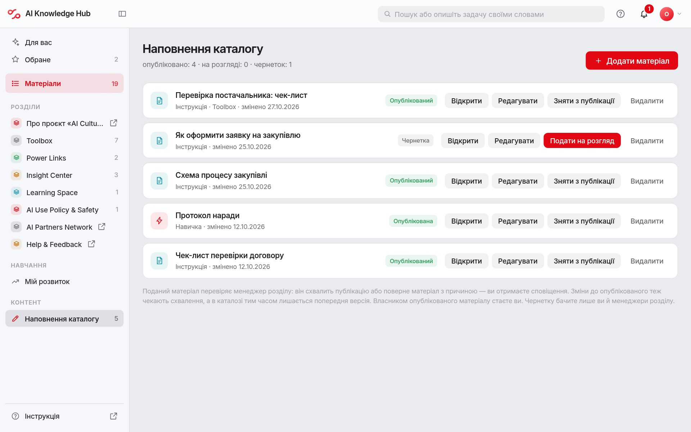

| Кнопка | Що робить |
| --- | --- |
| **Відкрити** | Показує картку так, як її бачать колеги |
| **Редагувати** | Змінює текст, назву, опис |
| **Зняти з публікації** | Ховає матеріал з каталогу, він стає чернеткою |
| **Опублікувати** | Повертає чернетку в каталог |
| **Видалити** | Видаляє матеріал назавжди |

**Додати файл до опублікованого матеріалу:** відкрийте картку й натисніть
**«Додати файл»** у блоці файлів.

**Якщо менеджер зняв матеріал з публікації,** ви отримаєте сповіщення з
причиною. Причину видно й у картці. Виправте матеріал і опублікуйте знову.

**Раз на пів року хаб нагадає перевірити актуальність.** Відкрийте меню
профілю → **«Мій контент»** і натисніть **«Актуальний»** або оновіть
матеріал.

---

## 8. Стежити за сповіщеннями

Червоне число на **дзвіночку** означає нові сповіщення.

1. Натисніть дзвіночок.
2. Клацніть сповіщення: відкриється картка, якої воно стосується.
3. **«Прочитати всі»** прибирає позначки нових.

Сповіщення приходять, коли хтось прокоментував ваш матеріал, менеджер зняв
його з публікації, позначив «Потребує оновлення» чи видалив, або настав час
перевірити актуальність.

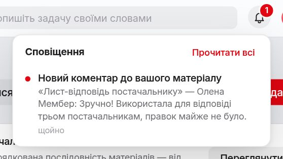

---

## 9. Мій розвиток

У бічній панелі натисніть **«Мій розвиток»**. Тут ваш рівень роботи з AI і
дата, коли його визначено, наступний крок, матеріали для вашого рівня й
навчальні маршрути. Сам рівень видно й на сторінці «Для вас» — під
привітанням.

**Рівень роботи з AI**

1. Натисніть **«Визначити мій рівень»** (або **«Змінити рівень»**) і
   оберіть свій.
2. Хаб почне рекомендувати матеріали саме для вас, а сторінка покаже
   наступний крок.

Коли підключать тест рівня, тут з'явиться кнопка **«Пройти тест»**: він
відкриється в новій вкладці.

**Навчальні маршрути** — добірки матеріалів від простого до складного.

1. Відкрийте маршрут на сторінці «Мій розвиток» і натисніть
   **«Продовжити»**.
2. Пройдений крок позначайте кнопкою з його номером. Прогрес видно на тій
   самій сторінці.

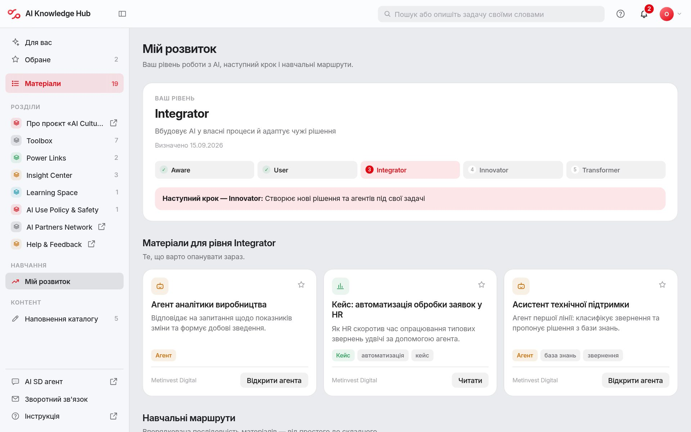

---

## 10. Запропонувати ідею

Не знайшли потрібного або знаєте, як покращити роботу з AI?

1. Натисніть **«Поділитися ідеєю»**: на сторінці «Для вас», у «Матеріалах»
   або в будь-якій картці.
2. Опишіть суть, бізнес-задачу й очікуваний ефект.
3. Натисніть **«Надіслати»**.

Статус ідеї й рішення команди хабу видно в меню профілю → **«Мої ідеї»**.

---

## 11. Профіль і тема

Натисніть **аватар** у правому верхньому куті.

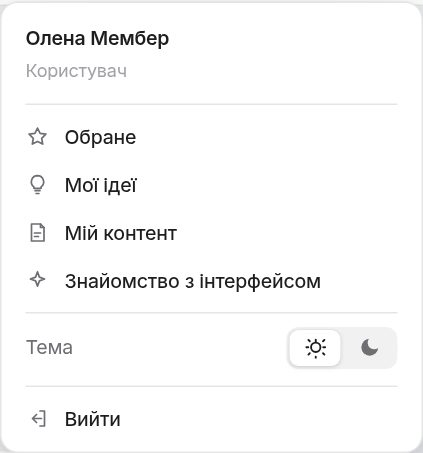

- **Обране**, **Мої ідеї**, **Мій контент** — особисті списки.
- **Знайомство з інтерфейсом** — ще раз пройти підказки по екрану.
- **Тема** — світла або темна.
- **Вийти** — завершити роботу. Інколи, не частіше разу на місяць, хаб
  попросить перед виходом оцінити його одним кліком; це можна пропустити.
  Якщо закрити вкладку без «Вийти», це питання з'явиться на початку
  наступного сеансу.

---

## На телефоні

- Унизу є вкладки: **«База знань»**, **«Матеріали»**, **«Обране»**.
- Бічна панель з розділами відкривається кнопкою ліворуч від логотипа.
- Усі дії ті самі, що й на комп'ютері.

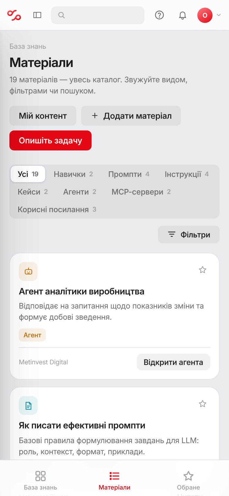

---

## Для менеджера розділу

Угорі є перемикач **«База знань» / «Керування»**. Число на «Керуванні»
показує, скільки матеріалів у ваших розділах чекає рішення.

1. Відкрийте **«Керування» → «Модерація»**.
2. У блоці **«На розгляді»** — подані матеріали й зміни до опублікованого.
   Подане ще не в каталозі; зміни не замінюють опубліковану версію, доки ви
   їх не схвалите.
3. **«Схвалити»** публікує матеріал. **«Повернути»** відправляє його авторові
   чернеткою: вкажіть причину, автор отримає її в сповіщенні.
4. **«Переглянути зміни»** показує, що було й що стане. Схваліть зміни або
   відхиліть їх із причиною.
5. **«Відкрити»** показує картку, **«Редагувати»** — повний редактор. У своїх
   розділах ви публікуєте власні матеріали одразу.

Нижче на тій самій сторінці: усі матеріали й навички ваших розділів із
фільтрами, коментарі й оцінки. Також вам доступні **«KPI хабу»** і
**«Використання»**.

Адміністратор бачить усі розділи й ще **«Структура каталогу»** (розділи,
колекції, довідники), **«Маршрути»** (там же посилання на тест рівня),
категорії навичок і **«Користувачі»**: облікові записи, ролі, розділи
менеджерів і позначки. Розділ **«Ідеї»** бачать відповідальні за ідеї.

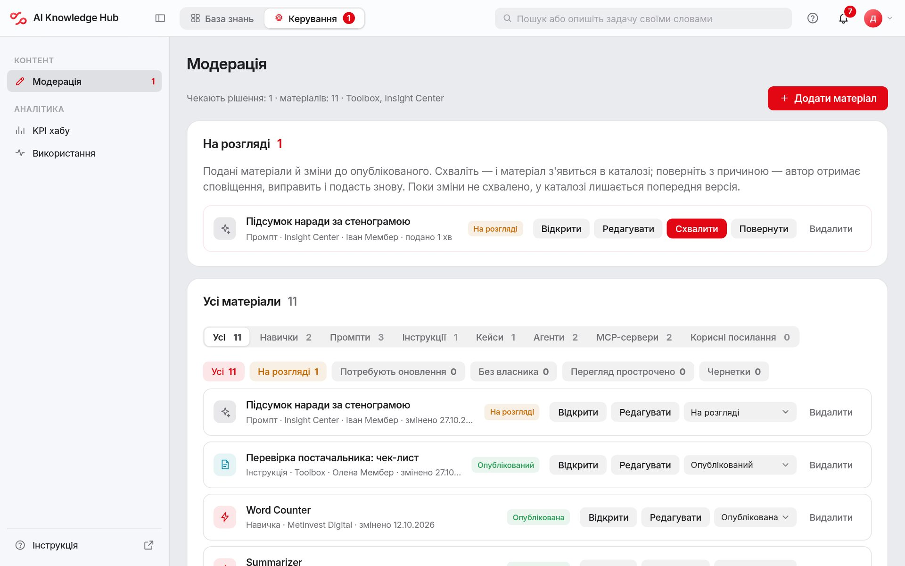

---

## Часті запитання

**Мій матеріал не видно в каталозі.**
Імовірно, це чернетка або матеріал ще на розгляді. Відкрийте «Наповнення
каталогу»: чернетку подайте на розгляд, а поданий матеріал з'явиться після
схвалення. Якщо менеджер повернув чи зняв матеріал, причина вказана в
сповіщенні й у картці.

**Хто бачить мою чернетку?**
Лише ви й менеджери розділу.

**Що означає позначка «Потребує оновлення»?**
Матеріал міг застаріти. Перш ніж використовувати, звірте його з чинними
правилами або зверніться до власника, вказаного в картці.

**Чи можна завантажити будь-який файл?**
Так. Текст із `.docx`, `.pdf`, `.md`, `.txt` хаб витягне в поле картки (з
`.docx` — разом із картинками); решта файлів прикріплюються до неї.
Зображення й відео показуються в картці одразу. Картинку можна вставити й
просто в текст кнопкою «Зображення».

**Пошук нічого не знайшов.**
Спробуйте «Опишіть задачу» або інші слова. Якщо матеріалу справді немає,
натисніть «Поділитися ідеєю» чи опублікуйте власне рішення.

**Можна вставити в промпт конфіденційні дані?**
Дотримуйтесь правил компанії щодо роботи з даними в AI. Інструкція
«Робота з конфіденційними даними в ШІ» є в каталозі.
